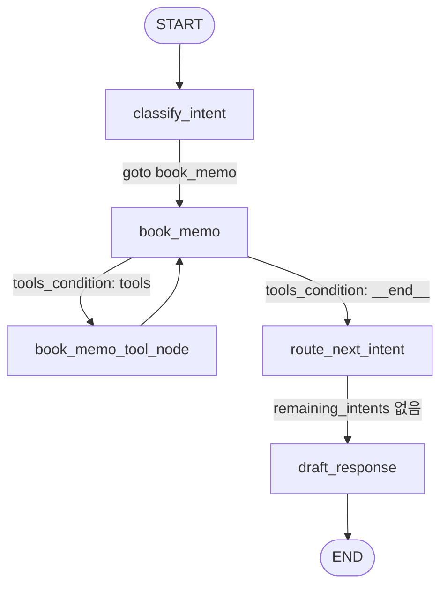

# 최근 LangSmith 트레이스 분석: book_memo 흐름

LangSmith MCP로 `book_chatbot` 프로젝트의 가장 최근 루트 트레이스를 조회하고, 코드(`src/book_chatbot/graph.py`, `tool.py`)와 대응시켜 정리한 문서입니다.

## 트레이스 개요

| 항목 | 값 |
|---|---|
| 프로젝트 | `book_chatbot` |
| Trace ID | `01a0bcd1-19ef-7431-a928-3a8a63f8f834` |
| 실행 시각 | 2026-09-20 03:16:55 UTC |
| 총 소요 시간 | 13.26초 |
| 상태 | success |
| 메타데이터 `revision_id` | `2e607fd-dirty` (커밋되지 않은 변경이 있는 상태에서 실행됨) |

**사용자 입력**

> 내가 생각을 넓혀주는 독서법 31페이지까지 읽었는데 깨달음에 의한 배움과 교육에 의한 배움에 차이가 있다는 부분이 인상적이었어

**최종 출력**: "독서 메모 정리해둘게." + 도서 / 읽은 범위(31페이지) / 인상 깊은 부분을 정리한 답변

## 전체 흐름



`book_memo`는 첫 호출에서 도구 호출을 내보내 `book_memo_tool_node`로 가고, 도구 결과를 받은 두 번째 호출에서 도구 호출 없이 응답해 `route_next_intent`로 나갑니다.

## 단계별 상세

LangGraph의 `graph:step:N` 태그 기준입니다.

| step | 노드 | 코드 위치 | 소요(초) | LLM 토큰 | 하는 일 |
|---|---|---|---|---|---|
| 1 | `classify_intent` | `graph.py:26` | 3.16 | 590 | 메시지에서 의도를 분류 |
| 2 | `book_memo` | `graph.py:73` | 2.43 | 584 | 도구 바인딩 LLM이 `book_memo_analyzer` 호출을 결정 |
| 3 | `book_memo_tool_node` | `graph.py:17` | 1.51 | 210 | `book_memo_analyzer` 실행 |
| 4 | `book_memo` | `graph.py:73` | 2.42 | 680 | 도구 결과를 보고 요약 응답 생성 |
| 5 | `route_next_intent` | `graph.py:93` | 0.00 | - | 남은 의도가 없어 `draft_response`로 이동 |
| 6 | `draft_response` | `graph.py:108` | 2.84 | 436 | 전체 메시지를 바탕으로 최종 답변 생성 |

LLM 호출은 총 5회이고 합계 약 2,500 토큰입니다. 소요 시간은 대부분 LLM 호출입니다(LLM 합계 약 12.3초 / 전체 13.26초).

### 1. `classify_intent` (step 1)

- `llm.with_structured_output(IntentClassifications)`로 분류 프롬프트를 보냅니다(`graph.py:28-44`).
- 결과: `book_memo` 한 개. 하위 쿼리는 책 제목, 31페이지, 인상 깊은 점을 정리한 문장으로 다시 쓰였습니다.
- 첫 의도를 처리하고 나머지는 `remaining_intents`에 담습니다(`graph.py:47-48`). 이번에는 의도가 하나라 빈 리스트입니다.
- `Command(goto="book_memo")`로 이동하며, 하위 쿼리가 `HumanMessage`로 `messages`에 추가됩니다.

### 2. `book_memo` — 도구 호출 결정 (step 2)

- `llm.bind_tools([basic_book_search, book_memo_analyzer])`로 호출합니다(`graph.py:75`).
- 출력 content는 빈 문자열(`""`)이고, 도구 호출만 포함된 응답입니다.
- `tools_condition`이 `tools`를 반환해 `book_memo_tool_node`로 갑니다(`graph.py:140`).

### 3. `book_memo_tool_node` (step 3)

- 실행된 도구는 `book_memo_analyzer` 하나입니다(`tool.py:63`).
- 도구 내부에서 `with_structured_output(schema=ReadingMemo)`를 쓰는 LLM 호출이 한 번 더 일어납니다(`tool.py:73`).
- 결과: `pages_read=31`, `impression='‘깨달음에 의한 배움’과 ‘교육에 의한 배움’의 차이가 인상적이었다.'`
- `basic_book_search`는 호출되지 않았습니다.

### 4. `book_memo` — 도구 결과 요약 (step 4)

- `book_memo_tool_node → book_memo` 엣지(`graph.py:141`)로 돌아와 도구 결과(`ToolMessage`)를 받습니다.
- 이번에는 도구 호출이 없어 `tools_condition`이 `__end__`를 반환하고, 매핑에 따라 `route_next_intent`로 갑니다(`graph.py:140`).

### 5. `route_next_intent` → 6. `draft_response`

- `remaining_intents`가 비어 있어 `draft_response`로 이동합니다(`graph.py:95-97`).
- `draft_response`는 시스템 프롬프트와 누적된 `messages` 전체로 LLM을 한 번 더 호출해 `draft_response` 상태 값과 최종 출력을 만듭니다(`graph.py:108-113`).

## 단계별 State 변화 (JSON)

`OverallState`(`schema.py:12`)의 키는 다섯 개입니다.

| 키 | 타입 | 리듀서 |
|---|---|---|
| `messages` | `list` | `add_messages` (반환값을 기존 리스트 뒤에 **추가**, id 없으면 부여) |
| `classification` | `list[FeatureClassification] \| None` | 없음 (덮어쓰기) |
| `remaining_intents` | `list[FeatureClassification]` | 없음 (덮어쓰기) |
| `draft_response` | `str \| None` | 없음 (덮어쓰기) |
| `search_results` | `list[dict]` | 없음 (덮어쓰기) |

### 읽는 방법

- 아래 JSON은 LangSmith가 기록한 각 노드의 **입력(input)**과 **출력(output)** 입니다. 입력은 노드 진입 시점의 state이고, 출력은 노드가 반환한 값(update)입니다.
- "적용 후 state"는 트레이스에 직접 기록된 값이 아니라, 입력에 출력을 리듀서 규칙대로 합쳐서 만든 값입니다.
- 트레이스의 입력에 나타나지 않은 키(`draft_response`, `search_results`)는 그 시점에 아직 값이 없는 키입니다.
- 같은 메시지가 매 단계에 반복되므로 아래 5개 메시지를 한 번만 정의하고, 이후에는 `H1`처럼 이름으로 표시합니다. 길이를 줄이려고 `response_metadata`, `usage_metadata`, `additional_kwargs`는 뺐고, 본문과 id는 원본 그대로입니다.

### 메시지 정의

```jsonc
// H1: 사용자가 입력한 원문 (START 입력)
{
  "type": "human",
  "id": "ae5f684e-79e7-4f50-a9f1-b48333643d73",
  "content": "내가 생각을 넓혀주는 독서법 31페이지까지 읽었는데 깨달음에 의한 배움과 교육에 의한 배움에 차이가 있다는 부분이 인상적이었어"
}

// H2: classify_intent가 하위 쿼리로 다시 쓴 메시지 (노드가 반환할 때는 id가 없고, add_messages가 id를 부여함)
{
  "type": "human",
  "id": "24395b32-98f8-44e5-bbb7-c3d25b26a06f",
  "content": "『내가 생각을 넓혀주는 독서법』 31페이지까지 읽었고, ‘깨달음에 의한 배움’과 ‘교육에 의한 배움’의 차이가 인상적이었다는 독서 메모"
}

// AI1: book_memo 첫 호출의 LLM 응답 — 본문은 비어 있고 도구 호출만 있음 (finish_reason: tool_calls, 입력 512 / 출력 72 토큰)
{
  "type": "ai",
  "id": "lc_run--01a0bcd1-29d0-7401-9dab-5d2ee8caa3a3-0",
  "content": "",
  "tool_calls": [
    {
      "name": "book_memo_analyzer",
      "id": "call_lZVWIk2UhSOdjwCkfbLjKFmn",
      "type": "tool_call",
      "args": { "memo_text": "『내가 생각을 넓혀주는 독서법』 31페이지까지 읽었고, ‘깨달음에 의한 배움’과 ‘교육에 의한 배움’의 차이가 인상적이었다는 독서 메모" }
    }
  ]
}

// T1: book_memo_tool_node가 만든 도구 결과 메시지
{
  "type": "tool",
  "id": "3d638368-d299-4307-b92a-db9d8f3456e0",
  "name": "book_memo_analyzer",
  "tool_call_id": "call_lZVWIk2UhSOdjwCkfbLjKFmn",
  "status": "success",
  "content": "pages_read=31 impression='‘깨달음에 의한 배움’과 ‘교육에 의한 배움’의 차이가 인상적이었다.'"
}

// AI2: book_memo 두 번째 호출의 LLM 응답 — 도구 호출 없이 텍스트 응답 (finish_reason: stop, 입력 631 / 출력 49 토큰)
{
  "type": "ai",
  "id": "lc_run--01a0bcd1-3936-7750-9b03-1f75c92a334b-0",
  "content": "- 읽은 페이지: 31페이지  \n- 감상(인상 깊었던 점): ‘깨달음에 의한 배움’과 ‘교육에 의한 배움’의 차이가 인상적이었다.",
  "tool_calls": []
}
```

`T1.content`는 JSON이 아니라 Pydantic 객체(`ReadingMemo`)를 문자열로 바꾼 값입니다. 도구가 반환한 객체는 `ToolNode`가 문자열로 변환해 `ToolMessage`에 넣습니다.

### 0. 시작 (START → classify_intent)

그래프 호출 입력입니다. 나머지 키는 비어 있습니다.

```json
{
  "messages": ["H1"]
}
```

### 1. `classify_intent`

**입력 state**
```json
{
  "messages": ["H1"]
}
```

**출력 (`Command`)** — `update`로 state를 바꾸고 `goto`로 다음 노드를 지정합니다.
```json
{
  "goto": "book_memo",
  "graph": null,
  "resume": null,
  "update": {
    "classification": [
      {
        "intent": "book_memo",
        "query_related_to_intent": "『내가 생각을 넓혀주는 독서법』 31페이지까지 읽었고, ‘깨달음에 의한 배움’과 ‘교육에 의한 배움’의 차이가 인상적이었다는 독서 메모"
      }
    ],
    "remaining_intents": [],
    "messages": ["H2 (id 없음)"]
  }
}
```

**적용 후 state**
```json
{
  "messages": ["H1", "H2"],
  "classification": [{ "intent": "book_memo", "query_related_to_intent": "…(H2와 같은 문장)" }],
  "remaining_intents": []
}
```

- `intents[0]`을 처리하고 `intents[1:]`를 `remaining_intents`에 넣는 코드(`graph.py:47-48`)에 따라, 의도가 하나라서 `remaining_intents`는 빈 리스트입니다.
- `messages`에 H2가 **추가**됩니다. 원문 H1은 지워지지 않고 그대로 남습니다.

### 2. `book_memo` (첫 번째 호출)

**입력 state**
```json
{
  "messages": ["H1", "H2"],
  "classification": [{ "intent": "book_memo", "query_related_to_intent": "…" }],
  "remaining_intents": []
}
```

**출력**
```json
{
  "messages": ["AI1"]
}
```

**적용 후 state**
```json
{
  "messages": ["H1", "H2", "AI1"],
  "classification": [{ "intent": "book_memo", "query_related_to_intent": "…" }],
  "remaining_intents": []
}
```

- 마지막 메시지(AI1)에 `tool_calls`가 있으므로 `tools_condition`이 `"tools"`를 반환합니다. 다음 노드는 `book_memo_tool_node`입니다.
- LLM은 `basic_book_search`와 `book_memo_analyzer` 중 `book_memo_analyzer`만 골랐고, `memo_text`로 H2의 본문을 그대로 넘겼습니다.

### 3. `book_memo_tool_node`

**입력 state**
```json
{
  "messages": ["H1", "H2", "AI1"],
  "classification": [{ "intent": "book_memo", "query_related_to_intent": "…" }],
  "remaining_intents": []
}
```

**출력**
```json
{
  "messages": ["T1"]
}
```

**적용 후 state**
```json
{
  "messages": ["H1", "H2", "AI1", "T1"],
  "classification": [{ "intent": "book_memo", "query_related_to_intent": "…" }],
  "remaining_intents": []
}
```

- `ToolNode`는 AI1의 `tool_calls`를 읽어 `book_memo_analyzer(memo_text=...)`를 실행합니다.
- 도구 내부 구조화 출력 결과(`tool.py:82`)입니다.
  ```json
  { "pages_read": 31, "impression": "‘깨달음에 의한 배움’과 ‘교육에 의한 배움’의 차이가 인상적이었다." }
  ```
- `T1.tool_call_id`가 AI1의 `tool_calls[0].id`와 같아야 LLM이 두 메시지를 짝으로 인식합니다. 이 값은 트레이스에서 서로 같은 `call_lZVWIk2UhSOdjwCkfbLjKFmn`입니다.
- 이 엣지(`book_memo_tool_node → book_memo`, `graph.py:141`) 때문에 다시 `book_memo`로 돌아갑니다.

### 4. `book_memo` (두 번째 호출)

**입력 state**
```json
{
  "messages": ["H1", "H2", "AI1", "T1"],
  "classification": [{ "intent": "book_memo", "query_related_to_intent": "…" }],
  "remaining_intents": []
}
```

**출력**
```json
{
  "messages": ["AI2"]
}
```

**적용 후 state**
```json
{
  "messages": ["H1", "H2", "AI1", "T1", "AI2"],
  "classification": [{ "intent": "book_memo", "query_related_to_intent": "…" }],
  "remaining_intents": []
}
```

- AI2에 `tool_calls`가 없어서 `tools_condition`이 `"__end__"`를 반환하고, 조건부 엣지 매핑(`graph.py:140`)에 따라 `route_next_intent`로 갑니다.

### 5. `route_next_intent`

**입력 state**: 4번의 적용 후 state와 같습니다 (`messages`는 5개).

**출력 (`Command`)**
```json
{
  "goto": "draft_response",
  "graph": null,
  "resume": null,
  "update": null
}
```

**적용 후 state**: 입력과 같습니다 (`update`가 `null`이라 변경 없음).

- `remaining_intents`가 빈 리스트라서 `not remaining`이 참이 되고, state 변경 없이 `draft_response`로 이동합니다(`graph.py:95-97`).

### 6. `draft_response`

**입력 state**: 5번과 같습니다.

**출력**
```json
{
  "draft_response": "독서 메모 정리해둘게.\n\n- 도서: 『내가 생각을 넓혀주는 독서법』  \n- 읽은 범위: 31페이지까지  \n- 인상 깊은 부분: ‘깨달음에 의한 배움’과 ‘교육에 의한 배움’은 서로 다르며, 그 차이를 구분해 설명한 대목이 특히 인상적이었다.\n\n원하면, 이 부분을 더 확장해서 메모를 “내 경험/사례 + 앞으로의 독서 적용” 형태로 2~3문장 더 붙여서 정리해줄 수도 있어."
}
```

### 최종 state (그래프 종료 시, 루트 run의 출력)

```json
{
  "messages": ["H1", "H2", "AI1", "T1", "AI2"],
  "classification": [{ "intent": "book_memo", "query_related_to_intent": "…" }],
  "remaining_intents": [],
  "draft_response": "독서 메모 정리해둘게. …"
}
```

- `draft_response`는 `messages`에 추가되지 않고 별도 키에만 저장됩니다. 사용자에게 보이는 최종 답변은 AI2가 아니라 이 값입니다.
- `search_results` 키는 최종 state에도 없습니다. 이 그래프의 어떤 노드도 이 키에 값을 쓰지 않습니다(`graph.py` 검색 결과).

### State 변화 요약

| 단계 | 노드 | `messages` | `classification` | `remaining_intents` | `draft_response` |
|---|---|---|---|---|---|
| 0 | START | H1 | - | - | - |
| 1 | `classify_intent` | H1, H2 | 1개 (`book_memo`) | `[]` | - |
| 2 | `book_memo` | H1, H2, AI1 | 동일 | `[]` | - |
| 3 | `book_memo_tool_node` | H1, H2, AI1, T1 | 동일 | `[]` | - |
| 4 | `book_memo` | H1, H2, AI1, T1, AI2 | 동일 | `[]` | - |
| 5 | `route_next_intent` | 동일 | 동일 | `[]` | - |
| 6 | `draft_response` | 동일 | 동일 | `[]` | 최종 답변 문자열 |

## 관찰 사항

- **`basic_book_search` 미호출**: `book_memo` 노드에는 책 검색 도구가 바인딩되어 있지만, 이번 실행에서는 호출되지 않았습니다. 따라서 답변의 도서명은 사용자 입력에서 온 값이며 알라딘 검색으로 확인된 서지 정보(저자, 출판사, ISBN)가 아닙니다. `BookMemoRecord`에 담는 메타데이터는 이 경로에서 채워지지 않습니다.
- **요약이 두 번 생성됨**: step 4(`book_memo`의 두 번째 호출)와 step 6(`draft_response`)이 모두 도구 결과를 요약하는 LLM 호출이라 내용이 겹칩니다. 이 두 호출이 전체 토큰의 약 45%(1,116 / 2,500)이고 소요 시간의 약 40%(5.26 / 13.26초)입니다.
- **LLM 중첩 호출**: `book_memo_analyzer` 도구 안에서도 LLM을 호출하므로, 도구 한 번에 LLM 호출이 한 번 더 발생합니다. 그래프 노드는 `gpt-5.2`(`graph.py:14`, 트레이스의 `model_name`은 `gpt-5.2-2025-12-11`)를 쓰고, 이 도구는 코드상 `gpt-4o`(`tool.py:72`)를 씁니다. 도구 쪽 모델명은 트레이스에서 따로 확인하지 않았고 코드 기준입니다.
- **`search_results` 미사용**: `OverallState`에 정의된 `search_results`(`schema.py:16`)는 `src/` 어디에서도 값을 쓰지 않습니다. 검색 결과는 `messages`의 `ToolMessage`로만 쌓입니다.
- **`revision_id`가 `-dirty`**: 이 트레이스는 커밋되지 않은 `graph.py`로 실행됐습니다. 위 노드 구성은 현재 작업 트리의 `graph.py`와 일치하지만, 커밋 이후 코드와의 일치는 보장되지 않습니다.

## 재현 방법

LangSmith MCP(`/mcp`로 OAuth 인증 후)에서 다음 순서로 조회했습니다.

1. `query_runs` — `project_name=book_chatbot`, `is_root=true`로 가장 최근 루트 run 조회
2. `query_runs` — 위 결과의 `trace_id`로 트레이스 내 전체 run 조회
